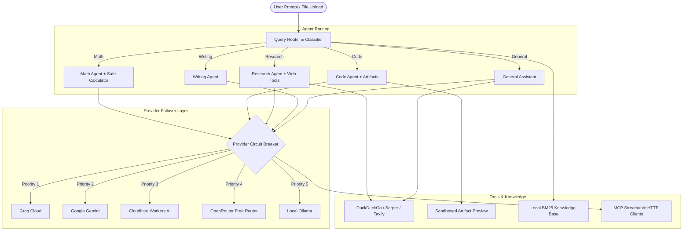

# 🌌 Morrow — Multi-Agent AI Workspace & Backend

Morrow is a self-hosted, privacy-focused, multi-agent AI assistant and workspace. Designed for resilient local execution, it brings together multi-provider LLM failover, specialized agent routing, safe native tools, local knowledge retrieval (RAG without vector databases), Model Context Protocol (MCP) integrations, and sandboxed code execution.

---

## 📑 Table of Contents

- [Key Features](#-key-features)
- [System Architecture](#-system-architecture)
- [Quick Start](#-quick-start)
  - [Prerequisites](#prerequisites)
  - [Installation](#installation)
  - [Configuration (.env)](#configuration-env)
  - [Running the App](#running-the-app)
- [Specialized Agent Roles](#-specialized-agent-roles)
- [Multi-Provider Routing & Free-Only Mode](#-multi-provider-routing--free-only-mode)
- [Native Tools & Web Search](#-native-tools--web-search)
- [Local Knowledge Base (BM25 RAG)](#-local-knowledge-base-bm25-rag)
- [AI Training Center & MCP](#-ai-training-center--mcp)
- [Project Structure](#-project-structure)
- [Running Tests](#-running-tests)
- [API Reference](#-api-reference)

---

## 🚀 Key Features

* **🔀 Multi-Provider Orchestration:** Seamless integration with **Google Gemini**, **Groq**, **Cloudflare Workers AI**, **OpenRouter**, and **Local Ollama**.
* **🛡️ Smart Failover & Circuit Breaker:** Automatic cooldown and failover if a provider rate-limits or fails, honoring `Retry-After` headers.
* **🆓 Zero-Cost / `FREE_ONLY` Mode:** Enforce zero-cost operation by restricting routing strictly to confirmed free-tier models and local instances.
* **🎯 Specialized Agent Routing:** Classifies prompts dynamically to dispatch to dedicated agents (**Math**, **Code**, **Research**, **Writing**, or **General**).
* **🧰 Native Tool Execution:** AST-validated safe calculator, web search, secured page reader, and conversation-scoped code generation.
* **🌐 Web Search & SSRF-Protected Reader:** Instant web search via **DuckDuckGo** (no API key required), **Serper**, or **Tavily**, with sandboxed HTTP scraping.
* **📚 Zero-Vector Local RAG:** Lightning-fast BM25 document indexing and citation over local Markdown files—no external vector database or embedding costs required.
* **🔌 Model Context Protocol (MCP):** Connect to live streamable HTTP/HTTPS MCP servers to dynamically discover and run external tools.
* **💻 Sandboxed Code Workspaces:** Generate, preview, and track version histories of multi-file code builds within conversation-isolated sandboxes.
* **🔒 Privacy & Memory Management:** SQLite-backed persistence, temporary/incognito chats (RAM-only), and explicit user memory control.

---

## 🏛️ System Architecture



---

## ⚡ Quick Start

### Prerequisites
* **Python 3.10+**
* Windows PowerShell or Linux/macOS Bash terminal
* (Optional) [Ollama](https://ollama.com/) installed locally for 100% offline usage

### Installation

1. **Clone or navigate** to the project directory:
   ```powershell
   cd D:\Agentic-Ai\MultiAgent
   ```

2. **Activate the included virtual environment** (or create a new one):
   * **PowerShell:**
     ```powershell
     .\.venv\Scripts\Activate.ps1
     ```
   * **Command Prompt:**
     ```cmd
     .venv\Scripts\activate.bat
     ```
   * **Bash (Linux/macOS):**
     ```bash
     source .venv/bin/activate
     ```

3. **Install dependencies:**
   ```powershell
   pip install -r requirements.txt
   ```

### Configuration (`.env`)

Copy `.env.example` to `.env` and configure your API keys:

```dotenv
# Operational Mode
FREE_ONLY=false

# LLM Providers (add whichever keys you have)
GEMINI_API_KEY=your_gemini_api_key_here
GROQ_API_KEY=your_groq_api_key_here
CLOUDFLARE_ACCOUNT_ID=your_cloudflare_account_id
CLOUDFLARE_API_TOKEN=your_cloudflare_api_token
OPENROUTER_API_KEY=your_openrouter_api_key
OLLAMA_BASE_URL=http://localhost:11434/v1
OLLAMA_MODEL=llama3.2

# Provider Failover Order
LLM_PROVIDER_PRIORITY=groq,gemini,cloudflare,openrouter,ollama
LLM_ENABLED_PROVIDERS=groq,gemini,cloudflare,openrouter,ollama

# Web Search Configuration
WEB_SEARCH_PROVIDER=DuckDuckGo   # DuckDuckGo (free, no key), Serper, or Tavily
SERPER_API_KEY=
TAVILY_API_KEY=
```

> [!NOTE]
> All credentials are read server-side only and are never exposed to the client browser.

### Running the App

#### Option A: FastAPI Web Application (Recommended)
Run the primary web application on port 8000:
```powershell
.\.venv\Scripts\python.exe -m uvicorn web_app:app --host 127.0.0.1 --port 8000
```
Open your browser and navigate to: **[http://localhost:8000](http://localhost:8000)**

#### Option B: Chainlit Interactive Interface
Alternatively, run the Chainlit-based UI:
```powershell
.\.venv\Scripts\python.exe -m chainlit run app.py -w
```

---

## 🎯 Specialized Agent Roles

Morrow inspects incoming prompts and routes them to specialized personas:

| Agent Route | Focus & Optimization | Registered Tools |
| :--- | :--- | :--- |
| **Math** | Low temperature, formal proofs, step-by-step arithmetic | `safe_calculator` |
| **Code** | Syntax compliance, modular structure, workspace building | `create_artifact`, `read_artifact_file` |
| **Research** | Fact verification, time-sensitive queries, source citation | `web_search`, `read_page`, BM25 Local Index |
| **Writing** | Tone calibration, structure drafting, email formatting | Style guides & governance prompts |
| **General** | Everyday assistance, multi-turn dialogue | Agent 1 / Agent 2 custom configurations |

---

## 🔄 Multi-Provider Routing & Free-Only Mode

### Resilient Circuit Breakers
- When an API provider returns an error (429, 500, or network timeout), that provider's circuit is temporarily cooled down.
- Automatic backoff respects standard HTTP `Retry-After` headers.
- Health status and live telemetry can be checked via the `/api/providers/status` endpoint.

### `FREE_ONLY=true` Protection
Setting `FREE_ONLY=true` in your `.env` guarantees you will never incur API charges:
* OpenRouter is strictly pinned to the `openrouter/free` endpoint.
* Cloudflare Workers AI is restricted to designated free-tier models (e.g., Gemma, GLM).
* Gemini and Groq enforce model-level free eligibility verification.
* Ollama operates locally over loopback endpoints.

---

## 🛠️ Native Tools & Web Search

1. **Safe Calculator:** Evaluates mathematical expressions using Python's Abstract Syntax Tree (`ast`), completely preventing arbitrary code execution.
2. **Web Search (`web_search`):** Supports **DuckDuckGo** (zero keys required), **Serper**, and **Tavily**. Configurable as `Auto`, `Always`, or `Off`.
3. **Safe Web Page Reader (`read_page`):** Fetches and cleans public HTTPS webpages. Rejects private IP ranges (anti-SSRF), protects against redirection loops, and strips malicious payload scripts.
4. **Document Parser:** Extracts text on the fly from uploaded `.pdf`, `.txt`, and `.md` files (up to 10 MB).

---

## 📖 Local Knowledge Base (BM25 RAG)

Morrow includes a zero-overhead local retrieval system:
* Reads Markdown knowledge files recursively from `../sociapi_agent_knowledge_base` (or the directory specified by `SOCIAPI_KNOWLEDGE_DIR`).
* Uses a **BM25 retrieval model** to score headings and excerpts against user queries.
* **Auto-Reload:** Watches file system timestamps; updating your markdown files refreshes knowledge immediately without retraining or vector database re-indexing.
* **Grounded Answers:** Answers cite specific markdown files and distinguish verified facts from drafts or historical notes.

---

## 🧠 AI Training Center & MCP

Access the **AI Training Center** directly from the web interface:

* **Custom Skills:** Write `SKILL.md` instructions or import packaged ZIP archives to enhance behavior dynamically.
* **Model Context Protocol (MCP):** Connect to streamable HTTP/HTTPS MCP servers. Morrow securely discovers tools and encrypts bearer tokens locally using AES encryption (`MultiAgent/data/`).
* **Document Library:** Index custom files (PDF, DOCX, CSV, TXT, web links) into your private library.
* **Few-Shot Examples:** Curate input/output training pairs and export them as JSONL to guide model styling.

---

## 📁 Project Structure

```
MultiAgent/
├── agents.py             # AgentFactory for Gemini, Groq, Cloudflare, OpenRouter, Ollama
├── agent_loop.py         # Multi-step function calling loop
├── app.py                # Chainlit UI implementation
├── artifacts.py          # Sandboxed code workspace & file preview engine
├── config.py             # Configuration loader, constants & branding
├── generation.py         # Response generation with fallback cascades
├── knowledge_base.py     # BM25-based local document search & auto-indexer
├── mcp_manager.py        # Streamable HTTP Model Context Protocol client
├── memory.py             # User memory and privacy filtering
├── orchestrator.py       # Task planner and execution safeguards
├── prompt_rules.py       # System prompts, few-shot examples & rules
├── provider_router.py    # Circuit breakers, cooldowns & failover logic
├── router.py             # Prompt classifier and agent dispatcher
├── storage.py            # SQLite database for sessions, preferences & library
├── tools.py              # Safe calculator, document parsing & artifact tools
├── web_app.py            # Primary FastAPI server with REST & SSE endpoints
├── web_search.py         # Search adapters (DuckDuckGo, Serper, Tavily) & page reader
└── tests/                # Unit test suite with mock providers
```

---

## 🧪 Running Tests

Execute the automated test suite without making external API calls (all providers are mocked):

```powershell
.\.venv\Scripts\python.exe -m unittest discover -s tests -v
```

---

## 📡 API Reference

| Method | Endpoint | Description |
| :--- | :--- | :--- |
| `GET` | `/` | Web application chat interface |
| `GET` | `/api/providers/status` | Current status, latency, and circuit breaker health |
| `GET` | `/api/knowledge/status` | Indexed knowledge files and document counts |
| `GET` | `/api/knowledge/search?q=...` | Debug search query against BM25 index |
| `POST` | `/api/knowledge/reload` | Force immediate reindexing of local Markdown files |
| `GET` | `/api/artifacts/{id}` | Inspect conversation code artifacts |

---

## 📄 License & Safety

* **Privacy First:** Chat logs and library files are stored locally in SQLite (`MultiAgent/data/`).
* **Sandboxed Security:** Tools enforce strict execution bounds and timeouts to eliminate infinite loops and unauthorized system access.
